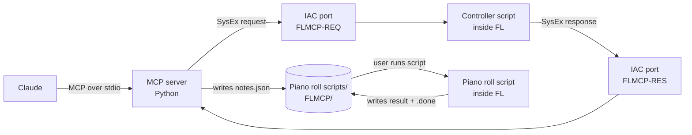

# FL Studio MCP: Project Plan

> **Goal:** Let Claude write chords, melodies and drums straight into FL Studio 2026 on macOS from a plain-language request, so composing gets faster.
> **Second goal:** Learn MCP and AI tool design by building every layer ourselves.

| | |
|---|---|
| Owner (engineer) | Mouli |
| Lead engineer / reviewer | Claude |
| Platform | macOS, FL Studio 2026 |
| Language | Python (MCP server and FL scripts) |
| AI client | Claude Desktop (any MCP client should work) |
| Last verified | 12 Nov 2026 (versions in §4, FL behaviour in [docs/file-mailbox-findings.md](docs/file-mailbox-findings.md)) |

---

## 1. What "done" looks like for v1

> From one Claude prompt like *"8-bar hip-hop idea in A minor, 90 BPM"*, chords, a melody and drums land in FL Studio in **under 2 minutes**, with **one manual click**.

### In scope (v1)
- Transport: play, stop, set tempo
- Writing notes into the piano roll (chords, melody), and drums into the Channel rack
- Music-theory helpers in Python (scales, chord progressions, drum patterns)
- Reading basic project info back (tempo, channels)

### Out of scope (v1)
- Windows support
- Loading plugins or choosing sounds (FL only allows this through its UI)
- Mixing, mastering, audio rendering
- Publishing to PyPI or hosting in the cloud

---

## 2. The limits that shape the design

FL Studio has **no external API**. Python only runs inside it, in two kinds of script, and FL runs both behind a **sandbox** that blocks most file access. Phase 0 tested this on FL 2026; the evidence is in [docs/file-mailbox-findings.md](docs/file-mailbox-findings.md).

| FL script | Runs | Can do | Files it may use |
|---|---|---|---|
| Controller script (`device_*.py`) | All the time; reacts to MIDI, including SysEx | Transport, mixer, channels, patterns, Channel rack steps | **Read only**, in its own folder. **No writing anywhere** |
| Piano roll script (`.pyscript`) | Only when the user runs it (piano roll **Tools → Scripts**) | Add, edit and delete notes | **Read and write** in `Settings/Piano roll scripts/` only. No renaming, deleting or making folders |

👉 Commands can't use files, so they travel inside **MIDI SysEx messages**.
👉 Notes can only be written by the piano roll script, so they travel as **files in its own folder**. The user runs the script **once per batch (one click)**. FL's built-in "Run last script again" (**Cmd+Opt+Y**) could remove that click later.

**Rules for all code that runs inside FL:**
- Import only `json`, `os`, `time` and FL's own modules. `datetime` crashes FL on "Reload script", and `tempfile` is blocked.
- Use the built-in `open()` only. Never create folders; the Mac side does that.
- Catch `Exception`, not just `OSError`: blocked calls raise `SystemError` or `TypeError`.

**Still true in FL Studio 2026:** the new scripting functions cover tempo, pattern length and swing, but none of them let a controller script write notes. Gopher (FL's built-in AI) can now control some features experimentally, but that's internal and not a public API.

---

## 3. Architecture



**Pattern: SysEx for commands, a file drop for notes**

**Commands** (play, stop, tempo, project info, drum steps):
1. The server puts the JSON request inside a SysEx message and sends it on the IAC port `FLMCP-REQ`.
2. The controller script receives it in `OnSysEx`, calls the FL API and replies on `FLMCP-RES`. In FL's MIDI settings, the input and output use the same **Port number**, which is how FL knows where to send replies.
3. Two ports, one per direction, so neither side ever hears its own messages.

**Notes** (chords, melody):
1. The server writes `notes.json` into `Settings/Piano roll scripts/FLMCP/`. It writes a temporary file and renames it, so FL never reads half a file.
2. The user runs **FLMCP_Notes** from the piano roll (Tools → Scripts).
3. The script adds the notes, then writes `result-<id>.json` followed by `result-<id>.done`. FL can't rename files, so the marker file is the "finished" signal.
4. The server reads the result and cleans up, because FL can't delete files.

*Analogy:* commands are **phone calls**: instant, and the answer comes straight back on a second line. Notes are a **parcel** left in FL's own mailbox, which FL opens when you press its button, then leaves a receipt.

---

## 4. Tech stack

| Part | Choice | Checked on 12 Nov 2026 |
|---|---|---|
| MCP protocol | Handled by the SDK | Latest spec: **2026-07-28** (stateless, no handshake) |
| MCP SDK | Official MCP Python SDK **v2** (`mcp`), class **`MCPServer`** | v2 is stable. `FastMCP` was renamed `MCPServer`; tutorials that import `mcp.server.fastmcp` are v1, so skip them |
| FL Studio | FL Studio 2026 (26.1), MIDI scripting API **45**, built-in Python **3.12.1** (sandboxed) | Released 7 Jul 2026 |
| Python | **3.12**, managed by `uv` | Chosen because `python-rtmidi` has no macOS ARM wheels above 3.12 |
| MIDI | `mido` + `python-rtmidi` | python-rtmidi 1.5.8 (no new release in a long time; see Risks) |
| Virtual MIDI cable | macOS IAC Driver with two ports: `FLMCP-REQ` (Mac → FL) and `FLMCP-RES` (FL → Mac) | Tested in Phase 0 |
| FL API autocomplete | `fl-studio-api-stubs` | 37.x |
| Testing | `pytest`, MCP Inspector | — |
| Lint/format | `ruff` | — |

---

## 5. Repo structure

```
fl-studio-mcp/
├── README.md                  # this plan
├── DECISIONS.md               # short log of design decisions
├── docs/
│   └── file-mailbox-findings.md   # Phase 0: what FL's sandbox allows, with evidence
├── pyproject.toml
├── src/fl_mcp/
│   ├── server.py              # creates MCP server, registers tools
│   ├── tools/                 # thin MCP tool wrappers
│   │   ├── transport.py
│   │   ├── notes.py
│   │   └── project.py
│   ├── bridge/                # talking to FL
│   │   ├── sysex.py           # JSON <-> SysEx message format
│   │   ├── link.py            # request/response over FLMCP-REQ / FLMCP-RES, timeouts
│   │   └── notes_drop.py      # writes notes.json, waits for the .done marker, cleans up
│   └── theory/                # pure Python, no MCP, no FL
│       ├── scales.py
│       ├── chords.py
│       └── drums.py
├── fl_scripts/
│   ├── device_FLMCP.py        # → Settings/Hardware/FLMCP/
│   └── FLMCP_Notes.pyscript   # → Settings/Piano roll scripts/
├── scripts/
│   ├── install_mac.sh         # copies FL scripts, creates Piano roll scripts/FLMCP/
│   └── doctor.py              # checks Python, ports and Port numbers, pings FL; re-run after FL updates
└── tests/
    ├── test_theory.py
    ├── test_sysex.py          # runs both copies of the message format on the same cases
    └── test_notes_drop.py
```

**Layering rule:** `theory/` knows nothing about MCP or FL. `bridge/` knows nothing about MCP. `tools/` only connects the two. This keeps most code testable without FL open.

**Phase 0 spikes** were throwaway and have been removed. The code is preserved in commit [`829de72`](https://github.com/moulibheemaneti/fl-studio-mcp/tree/829de72e455f7cc9dbae31fe628f7618534f293a), and the results are in [docs/file-mailbox-findings.md](docs/file-mailbox-findings.md).

**One message format, two copies:** FL can't import our package, so `device_FLMCP.py` carries its own copy of the SysEx format. `tests/test_sysex.py` runs both copies on the same cases so they can't drift apart.

---

## 6. Data contracts

### Commands: SysEx messages
Every message, in both directions:

```
F0  7D  46 4D  <kind>  <ASCII JSON>  F7
```
- `7D`: MIDI's manufacturer ID for non-commercial use. `46 4D` = "FM", our tag.
- `kind`: `01` request (Mac → FL), `02` response (FL → Mac), `03` event (FL → Mac, e.g. a heartbeat).
- JSON is written with `ensure_ascii=True`, so every byte stays below `0x80`, as SysEx requires.
- Messages are capped at **8 KB**. Phase 0 tested 16 KB, so there's a safety margin; anything bigger needs chunking later.

```json
{ "id": "a91b…", "command": "set_tempo", "args": { "bpm": 90 } }
{ "id": "a91b…", "ok": true, "result": { "bpm": 90 } }
{ "id": "a91b…", "ok": false, "error": { "code": "fl_error", "message": "…" } }
```
- Tempo is always plain **BPM**. FL reports BPM × 1000, and the controller script converts it.

### Notes: `Settings/Piano roll scripts/FLMCP/notes.json`
Positions are in **beats**, not ticks. The piano roll script converts them using FL's PPQ.

```json
{
  "id": "2f1c…",
  "created_at": "2026-11-12T10:00:00Z",
  "mode": "append",
  "notes": [
    { "pitch": 57, "start_beat": 0.0, "length_beats": 1.0, "velocity": 0.8 }
  ]
}
```
- `pitch`: MIDI number (60 = C5 in FL)
- `velocity`: 0.0–1.0
- `mode`: `append` or `replace`
- `created_at` is written by the Mac side; FL never reads it.

### Notes result: `result-<id>.json`, then `result-<id>.done`
```json
{ "id": "2f1c…", "ok": true, "added": 32 }
```
- FL writes the `.json` first and the `.done` marker last. The marker means "finished".
- If a `.done` for that `id` already exists, the script does nothing, so running it twice can't add notes twice.

---

## 7. MCP tools (v1)

| Tool | Phase | Path | What it does |
|---|---|---|---|
| `get_scale(root, mode)` | 1 | — | Returns the notes of a scale |
| `play()` / `stop()` | 3 | SysEx | Transport |
| `set_tempo(bpm)` | 3 | SysEx | Sets project tempo |
| `set_swing(amount)` *(optional)* | 3 | SysEx | Uses the new FL 2026 swing function, which suits hip-hop |
| `set_pattern_length(bars)` *(optional)* | 3 | SysEx | Uses the new FL 2026 pattern-length function |
| `add_notes(notes, mode)` | 4 | Notes file | Queues notes for the piano roll, then waits for the user's click |
| `add_chord_progression(key, mode, numerals, bars)` | 5 | Notes file | Builds chords with theory code, then queues them |
| `add_drum_pattern(style, bars)` | 5 | SysEx | Builds a kick/snare/hat pattern and writes it into the Channel rack steps, **with no click** |
| `get_project_info()` | 6 | SysEx | Tempo, channel names, current pattern |

**Tool rules**
- The description is a prompt: say *when* to use the tool, not only what it does.
- Inputs have clear types, ranges and examples.
- Every tool returns a short human-readable result plus data.
- Never `print()` to stdout. stdout is the MCP channel, so log to stderr instead.
- When FL doesn't answer, say what to check (FL open? script selected? ports and Port numbers?) instead of a bare timeout.

---

## 8. Phases

Each phase = one branch + one PR, reviewed by the lead engineer.

### Phase 0: Setup and spikes ✅
- [x] `uv` project created, Python **3.12** pinned
- [x] Confirm `mcp` (v2) and `python-rtmidi` both install cleanly on 3.12
- [x] IAC Driver online with two ports, `FLMCP-REQ` and `FLMCP-RES`
- [x] FL API stubs installed for autocomplete
- [x] **Spike:** FL's built-in Python and its file sandbox ([findings](docs/file-mailbox-findings.md)). This ruled out the file mailbox
- [x] **Spike:** SysEx round trip with FL (0.2 ms, 16 KB per message both ways)
- [x] **Spike:** the piano roll script can read and write in its own folder
- [x] Spikes removed after recording the results (kept in commit `829de72`)
- **Done when:** the Phase 0 setup check showed 9/9 ✅

### Phase 1: Hello MCP (no FL yet)
- [ ] `server.py` using `MCPServer` with one tool: `get_scale`
- [ ] Tested in MCP Inspector
- [ ] Connected to Claude Desktop
- **Learn:** tools, input schemas, stdio transport, how Claude picks tools
- **Done when:** Claude answers "what notes are in D minor?" by calling our tool

### Phase 2: Hello FL over SysEx (no MCP)
- [ ] `bridge/sysex.py`: message encode/decode, with unit tests (no FL needed)
- [ ] `bridge/link.py`: send a request, wait for the reply with the same `id`, time out with a clear error
- [ ] `device_FLMCP.py`: handles `ping`, `play`, `stop`, `set_tempo` in `OnSysEx`, catches every error and replies with an error code
- [ ] `install_mac.sh`: copies the FL scripts and creates `Piano roll scripts/FLMCP/`
- [ ] `doctor.py`: checks Python, packages, both IAC ports and the Port number match, then pings `device_FLMCP.py`
- [ ] Clear errors when FL is closed, the script isn't selected, or the Port numbers don't match
- **Learn:** MIDI SysEx, FL callbacks (`OnInit`, `OnSysEx`), request/response with ids
- **Done when:** a terminal command makes FL play, stop and change tempo, and says clearly what's wrong when FL is closed

### Phase 3: Connect them
- [ ] `play`, `stop`, `set_tempo` MCP tools use `bridge/link.py`
- [ ] Optional: `set_swing`, `set_pattern_length` (new FL 2026 functions)
- **Learn:** the full request path, error handling for AI tools
- **Done when:** "play at 90 BPM" works from Claude

### Phase 4: Notes v1
- [ ] `bridge/notes_drop.py`: writes `notes.json` (temporary file + rename), waits for `result-<id>.done`, reads the result, cleans up
- [ ] `FLMCP_Notes.pyscript`: **no dialog**. Reads `notes.json`, converts beats to ticks with `score.PPQ`, adds notes, writes result + `.done`, skips batches it already applied
- [ ] Before writing, the controller script opens the piano roll on the target channel (over SysEx), so the one click is easy
- [ ] If nobody clicks, the tool tells Claude to ask the user to run **FLMCP_Notes**
- **Learn:** data contracts between two programs, safe file handover
- **Done when:** Claude writes a 4-bar melody and you hear it after one click

### Phase 5: Music brain
- [ ] `theory/` module: scales, chords (Roman numerals), drum patterns
- [ ] Unit tests for theory code
- [ ] `add_chord_progression` (notes file) and `add_drum_pattern` (Channel rack steps over SysEx, no click)
- **Learn:** what goes in code (facts) vs what Claude decides (taste)
- **Done when:** "hip-hop beat in A minor" → chords + drums in FL

### Phase 6: Context
- [ ] `get_project_info` over SysEx
- [ ] Optional: MCP prompt template like "start a beat"
- **Learn:** resources, prompts, feedback loops
- **Done when:** Claude suggests a next step based on your actual project

### Stretch (after v1)
- Remove the manual click: run **FLMCP_Notes** once per session, then trigger **Cmd+Opt+Y** ("Run last script again") from the server. Needs macOS Accessibility permission
- Chunking for messages above 8 KB
- A heartbeat from FL, so the server knows FL is alive before sending
- Melody generation that avoids clashing with the chords
- Save and reuse "beat templates"

---

## 9. Risks

| Risk | Plan |
|---|---|
| Notes need a manual click | Accept for v1; Cmd+Opt+Y auto-run as a stretch goal |
| FL's file sandbox is undocumented and could change in any update | Use files only where tested (piano roll folder). Re-run `scripts/doctor.py` after FL updates. To re-test the sandbox itself, run the Phase 0 spikes from commit `829de72` |
| SysEx size limits | 16 KB tested; cap at 8 KB; add chunking only if needed |
| The two copies of the message format drift apart | `tests/test_sysex.py` runs both on the same cases |
| Port numbers or ports set up wrong in FL | `ping` on startup, plus setup-specific error messages |
| "Reload script" crashes FL | FL-side import rules in §2 (no `datetime`). If it still happens, restart FL instead |
| SDK v1 vs v2 confusion | Follow v2 docs only (`MCPServer`, not `FastMCP`); pin `mcp>=2,<3` |
| `python-rtmidi` is barely maintained | Pin Python 3.12. Watch for a release or a maintained fork |
| Image-Line ships an official AI/project API | Watch FL release notes. If one appears, swap `bridge/` and keep everything else |
| FL updates change the scripting API | Keep FL-specific code in `fl_scripts/` only |
| Claude picks the wrong tool | Improve descriptions first, before adding code |

---

## 10. Working agreement
- Small PRs, one phase at a time.
- Record every non-obvious choice in `DECISIONS.md` (date + 2 lines).
- Read FL's official manual before designing FL-side behaviour; then test it on the real FL.
- Other FL MCP repos are reference only, never copied. We read them early, in Phase 0, because of the sandbox (see `docs/`).
