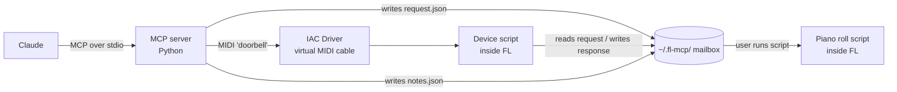

# FL Studio MCP — Project Plan

> **Goal:** Let Claude write chords, melodies and drums straight into FL Studio 2026 on macOS from a plain-language request, so composing gets faster.
> **Second goal:** Learn MCP and AI tool design by building every layer ourselves.

| | |
|---|---|
| Owner (engineer) | Mouli |
| Lead engineer / reviewer | Claude |
| Platform | macOS, FL Studio 2026 |
| Language | Python (MCP server and FL scripts) |
| AI client | Claude Desktop (any MCP client should work) |
| Last verified | 12 Nov 2026 (versions in §4) |

---

## 1. What "done" looks like for v1

> From one Claude prompt like *"8-bar hip-hop idea in A minor, 90 BPM"*, chords, a melody and drums land in FL Studio in **under 2 minutes**, with **one manual click**.

### In scope (v1)
- Transport: play, stop, set tempo
- Writing notes into the piano roll (chords, melody, drums)
- Music-theory helpers in Python (scales, chord progressions, drum patterns)
- Reading basic project info back (tempo, channels)

### Out of scope (v1)
- Windows support
- Loading plugins or choosing sounds (FL only allows this through its UI)
- Mixing, mastering, audio rendering
- Publishing to PyPI or hosting in the cloud

---

## 2. The limit that shapes the design

FL Studio has **no external API**. Python only runs inside it, in two places:

| FL environment | Runs | Can do |
|---|---|---|
| Device script (`device_*.py`) | All the time, reacts to MIDI | Transport, mixer, channels, patterns |
| Piano roll script (`.pyscript`) | Only when the user runs it from the menu | Add, edit and delete notes |

👉 Notes can only be written when the user runs our piano roll script (**once per batch, one click**).

**Still true in FL Studio 2026:** the new scripting functions cover tempo, pattern length and swing, but none of them let a device script write notes. Gopher (FL's built-in AI) can now control some features experimentally, but that's internal and not a public API.

---

## 3. Architecture



**Pattern: file mailbox + MIDI doorbell**
- The server writes the command as JSON into the mailbox folder.
- It sends one MIDI message (the "doorbell") over the IAC Driver.
- The device script wakes up, reads the JSON, calls the FL API, and writes a response file.
- Notes go to `notes.json`, which the piano roll script reads when the user runs it.

*Analogy:* we leave a letter in the mailbox and ring the bell. FL opens the door, reads the letter, does the job, and leaves a reply in the mailbox.

---

## 4. Tech stack

| Part | Choice | Checked on 12 Nov 2026 |
|---|---|---|
| MCP protocol | Handled by the SDK | Latest spec: **2026-07-28** (stateless, no handshake) |
| MCP SDK | Official MCP Python SDK **v2** (`mcp`), class **`MCPServer`** | v2 is stable. `FastMCP` was renamed `MCPServer`; tutorials that import `mcp.server.fastmcp` are v1, so skip them |
| FL Studio | FL Studio 2026 (26.1) | Released 7 Jul 2026 |
| Python | **3.12**, managed by `uv` | Chosen because `python-rtmidi` has no macOS ARM wheels above 3.12 |
| MIDI | `mido` + `python-rtmidi` | python-rtmidi 1.5.8 (no new release in a long time; see Risks) |
| Virtual MIDI cable | macOS IAC Driver (Audio MIDI Setup) | — |
| FL API autocomplete | `fl-studio-api-stubs` | 37.x |
| Testing | `pytest`, MCP Inspector | — |
| Lint/format | `ruff` | — |

---

## 5. Repo structure

```
fl-studio-mcp/
├── PLAN.md                    # this file
├── README.md                  # setup + usage
├── DECISIONS.md               # short log of design decisions
├── pyproject.toml
├── src/fl_mcp/
│   ├── server.py              # creates MCP server, registers tools
│   ├── tools/                 # thin MCP tool wrappers
│   │   ├── transport.py
│   │   ├── notes.py
│   │   └── project.py
│   ├── bridge/                # talking to FL
│   │   ├── mailbox.py         # read/write JSON in ~/.fl-mcp/
│   │   └── midi.py            # doorbell over IAC Driver
│   └── theory/                # pure Python, no MCP, no FL
│       ├── scales.py
│       ├── chords.py
│       └── drums.py
├── fl_scripts/
│   ├── device_FLMCP.py        # → ~/Documents/Image-Line/FL Studio/Settings/Hardware/FLMCP/
│   └── FLMCP_Notes.pyscript   # → ~/Documents/Image-Line/FL Studio/Settings/Piano roll scripts/
├── scripts/
│   └── install_mac.sh         # copies FL scripts, creates mailbox folder
└── tests/
    ├── test_theory.py
    └── test_mailbox.py
```

**Layering rule:** `theory/` knows nothing about MCP or FL. `bridge/` knows nothing about MCP. `tools/` only connects the two. This keeps most code testable without FL open.

---

## 6. Data contracts

### Notes (`~/.fl-mcp/notes.json`)
Positions are in **beats**, not ticks. The piano roll script converts them using FL's PPQ.

```json
{
  "id": "2f1c…",
  "created_at": "2026-11-12T10:00:00Z",
  "mode": "append",
  "notes": [
    { "pitch": 57, "start_beat": 0.0, "length_beats": 1.0, "velocity": 0.8 }
  ]
}
```
- `pitch`: MIDI number (60 = C5 in FL)
- `velocity`: 0.0–1.0
- `mode`: `append` or `replace`

### Commands (`~/.fl-mcp/request.json` → `response.json`)
```json
{ "id": "a91b…", "command": "set_tempo", "args": { "bpm": 90 } }
{ "id": "a91b…", "ok": true, "result": { "bpm": 90 } }
```

---

## 7. MCP tools (v1)

| Tool | Phase | What it does |
|---|---|---|
| `get_scale(root, mode)` | 1 | Returns the notes of a scale |
| `play()` / `stop()` | 3 | Transport |
| `set_tempo(bpm)` | 3 | Sets project tempo |
| `set_swing(amount)` *(optional)* | 3 | Uses the new FL 2026 swing function, which suits hip-hop |
| `set_pattern_length(bars)` *(optional)* | 3 | Uses the new FL 2026 pattern-length function |
| `add_notes(notes, mode)` | 4 | Queues notes for the piano roll |
| `add_chord_progression(key, mode, numerals, bars)` | 5 | Builds chords with theory code, then queues them |
| `add_drum_pattern(style, bars)` | 5 | Builds kick/snare/hat pattern, then queues it |
| `get_project_info()` | 6 | Tempo, channel names, current pattern |

**Tool rules**
- The description is a prompt: say *when* to use the tool, not only what it does.
- Inputs have clear types, ranges and examples.
- Every tool returns a short human-readable result plus data.
- Never `print()` to stdout. stdout is the MCP channel, so log to stderr instead.

---

## 8. Phases

Each phase = one branch + one PR, reviewed by the lead engineer.

### Phase 0 — Setup
- [ ] `uv` project created, Python **3.12** pinned
- [ ] Confirm `mcp` (v2) and `python-rtmidi` both install cleanly on 3.12
- [ ] IAC Driver enabled (Audio MIDI Setup → IAC Driver → "Device is online")
- [ ] FL API stubs installed for autocomplete
- [ ] **Spike:** confirm FL's built-in Python can `open()` files and `import json`
- **Done when:** the IAC port shows up in FL → Options → MIDI Settings

### Phase 1 — Hello MCP (no FL yet)
- [ ] `server.py` using `MCPServer` with one tool: `get_scale`
- [ ] Tested in MCP Inspector
- [ ] Connected to Claude Desktop
- **Learn:** tools, input schemas, stdio transport, how Claude picks tools
- **Done when:** Claude answers "what notes are in D minor?" by calling our tool

### Phase 2 — Hello FL (no MCP)
- [ ] `device_FLMCP.py` loads in FL without errors
- [ ] Small Python script sends a doorbell → FL starts playing
- [ ] Mailbox read/write working from inside FL
- **Learn:** MIDI messages, FL callbacks (`OnControlChange`, `OnInit`)
- **Done when:** a terminal command makes FL play and stop

### Phase 3 — Connect them
- [ ] `play`, `stop`, `set_tempo` tools use the mailbox + doorbell
- [ ] `set_tempo` uses FL's built-in tempo function (added in FL 2025.2.4), with no workarounds
- [ ] Timeout + clear error if FL is closed or the script is off
- **Learn:** the full request path, error handling for AI tools
- **Done when:** "play at 90 BPM" works from Claude

### Phase 4 — Notes v1
- [ ] `add_notes` writes `notes.json`
- [ ] `FLMCP_Notes.pyscript` reads it, adds notes, marks the batch applied
- **Learn:** data contracts between two programs
- **Done when:** Claude writes a 4-bar melody and you hear it after one click

### Phase 5 — Music brain
- [ ] `theory/` module: scales, chords (Roman numerals), drum patterns
- [ ] Unit tests for theory code
- [ ] `add_chord_progression`, `add_drum_pattern` tools
- **Learn:** what goes in code (facts) vs what Claude decides (taste)
- **Done when:** "hip-hop beat in A minor" → chords + drums in FL

### Phase 6 — Context
- [ ] `get_project_info` via response file
- [ ] Optional: MCP prompt template like "start a beat"
- **Learn:** resources, prompts, feedback loops
- **Done when:** Claude suggests a next step based on your actual project

### Stretch (after v1)
- Auto-run the piano roll script (remove the manual click)
- Melody generation that avoids clashing with the chords
- Save and reuse "beat templates"

---

## 9. Risks

| Risk | Plan |
|---|---|
| Notes need a manual click | Accept for v1; investigate auto-run as a stretch goal |
| FL's Python may lack some standard modules | Phase 0 spike before building on it |
| SDK v1 vs v2 confusion | Follow v2 docs only (`MCPServer`, not `FastMCP`); pin `mcp>=2,<3` |
| `python-rtmidi` is barely maintained | Pin Python 3.12. Fallback: drop the doorbell and have the device script check the mailbox on its idle callback (test this in Phase 2) |
| Image-Line ships an official AI/project API | Watch FL release notes. If one appears, swap `bridge/` and keep everything else |
| FL updates change the scripting API | Keep FL-specific code in `fl_scripts/` only |
| Claude picks the wrong tool | Improve descriptions first, before adding code |

---

## 10. Working agreement
- Small PRs, one phase at a time.
- Record every non-obvious choice in `DECISIONS.md` (date + 2 lines).
- Read other FL MCP repos only **after Phase 3**, as reference, not as copy.
